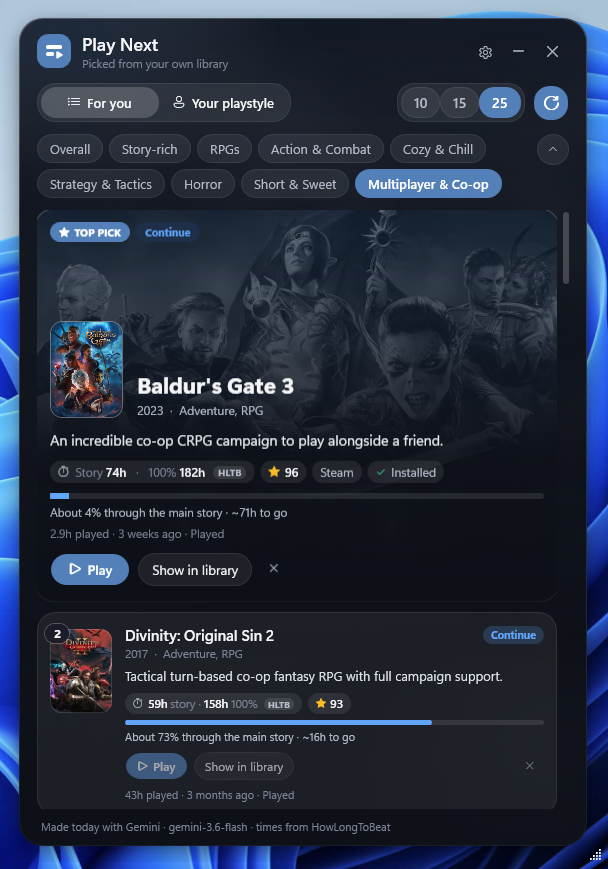
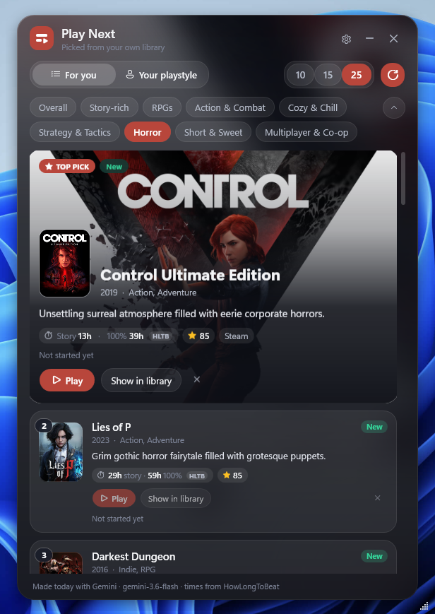
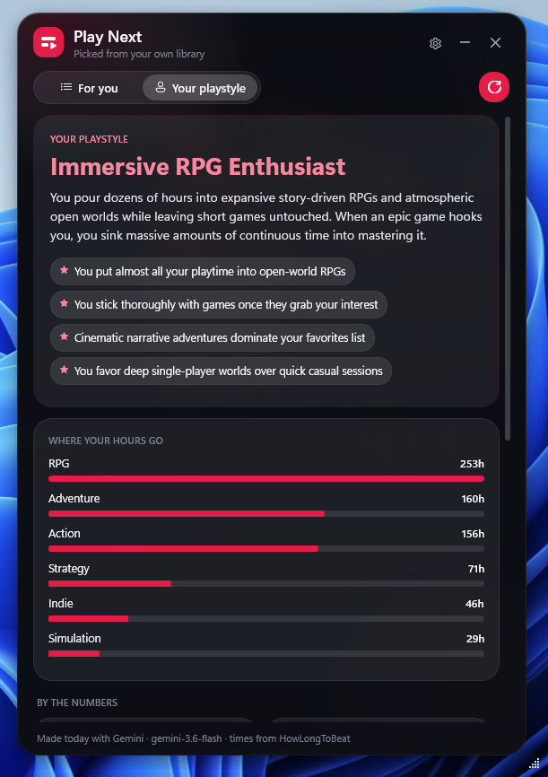
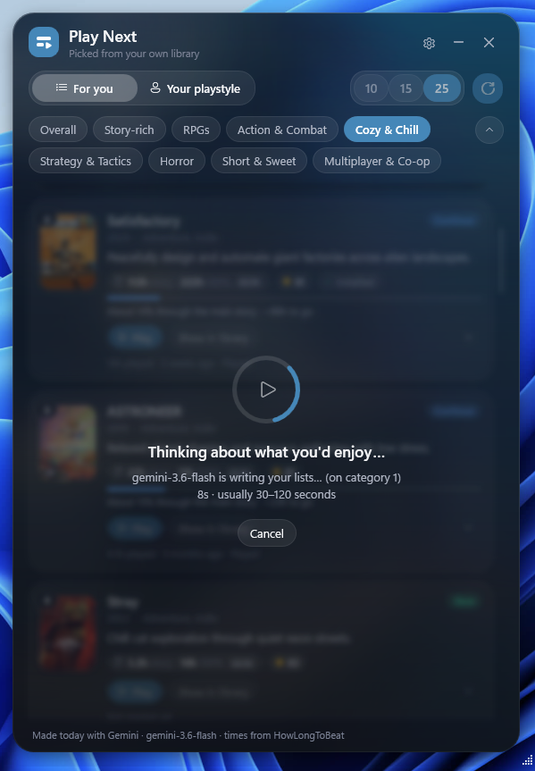

<p align="center">
  
</p>

<h1 align="center">Play Next</h1>

<p align="center">
  <b>Can't decide what to play? Play Next looks at your Playnite library and tells you.</b>
</p>

<p align="center">
  <a href="https://github.com/ahar2611/PlayNext/releases/latest"><b>Download the latest release</b></a> ·
  <a href="#getting-started">Getting started</a> ·
  <a href="CHANGELOG.md">Changelog</a>
</p>

---

Got a huge library and no idea what to play? Same.

Play Next goes through your [Playnite](https://playnite.link) library and picks what you should play next. It looks at how much you've played each game, what you finished, what you gave up on, your favorites and the genres you keep coming back to. Then it gives you a ranked list with a short reason for every pick, like *"You were really into this last month, so finish it off."*

<p align="center">
  
  
  
</p>

## What it does

- **Ranked picks from games you already own.** You get an Overall list, plus lists for Story-rich, RPGs, Action & Combat, Cozy & Chill, Strategy & Tactics, Horror, Short & Sweet and Multiplayer & Co-op. Switch between Top 10, 15 or 25. You can rename, add or remove categories.
- **A reason for every pick.** It's one plain sentence, not marketing copy, and each game is tagged **New**, **Continue** or **Revisit**.
- **How long to beat.** Cards show story and 100% times from HowLongToBeat, and a progress bar for games you're partway through. If you use the [HowLongToBeat add-on](https://github.com/Lacro59/playnite-howlongtobeat-plugin), its saved data is used directly.
- **Your playstyle.** A short write-up of how you play, where your hours actually go, and stats like your finish rate and backlog size.
- **One click updates everything.** A single refresh rebuilds every list and your playstyle, so switching categories afterwards is instant.
- **Always within reach.** Open it from Playnite's sidebar, or from the icon next to your clock without bringing Playnite up at all.
- **Looks the part.** It's a glass-style window that takes its color from your top game's artwork, or from any color you choose.

<p align="center">
  
</p>

## Getting started

1. **Install:** download the `.pext` file from the [latest release](https://github.com/ahar2611/PlayNext/releases/latest), then double-click it (or drag it onto Playnite) and restart Playnite when asked.
2. **Get a free AI key:** sign in at [Google AI Studio](https://aistudio.google.com/apikey) and click **Create API key**. It takes about a minute and costs nothing.
3. **Add the key:** in Playnite, go to **Settings → Extensions → Generic → Play Next**, paste the key and click **Test connection**.
4. **Open Play Next** from the sidebar button or the tray icon by your clock, and click **Refresh**. The first lists take about 30 to 120 seconds.

> Requires Playnite 10 on Windows.

### AI options

| Provider | Cost | Notes |
|---|---|---|
| **Google Gemini** (default) | Free tier | Uses `gemini-3.6-flash` and automatically tries other models if one is busy. |
| **Anthropic Claude** | Paid per use | Optional. Key from [console.anthropic.com](https://console.anthropic.com). |
| **Built-in** | Free, offline | No key or internet needed. Picks come from your stats, with simpler reasons. |

## Privacy

- Your API key is stored **encrypted on your PC** (Windows DPAPI) and only sent to the provider you picked.
- When you refresh, a **text summary of your library** (game names, genres, tags, playtime, completion status and scores) is sent to that provider. Nothing else leaves your PC. Google may use requests on its free tier to improve its products.
- HowLongToBeat lookups send game names to howlongtobeat.com. You can turn this off in settings.

## Tips and troubleshooting

- **Want the tray icon always there?** In Playnite's settings, turn on starting with Windows, starting minimized and minimizing to the tray. On Windows 11 the icon pins itself next to the clock the first time. You can hide it from its right-click menu.
- **"None of the Gemini models worked"** usually means Google's free tier is busy or you've hit its rate limit. Wait a minute and try again.
- **Times show "AI est." instead of "HLTB"** when a game couldn't be found on HowLongToBeat.
- **Something else?** Search `%AppData%\Playnite\playnite.log` for "Play Next" and [open an issue](https://github.com/ahar2611/PlayNext/issues) with what you find.

## Building from source

You need the .NET SDK (8 or newer). The project targets .NET Framework 4.6.2, like Playnite 10 itself.

```bash
dotnet build src/PlayNext.csproj -c Release
```

Zip `PlayNext.dll`, `extension.yaml`, `icon.png` and `sidebar.png` from `src/bin/Release` and rename the zip to `.pext`. Pushing a `v*` tag does this automatically through GitHub Actions and attaches the `.pext` to a draft release.

## Credits

- Game length data from [HowLongToBeat](https://howlongtobeat.com). Play Next isn't affiliated with HowLongToBeat.
- Built for [Playnite](https://playnite.link) by Josef Nemec and contributors.

## License

[MIT](LICENSE) © 2026 Lanney
